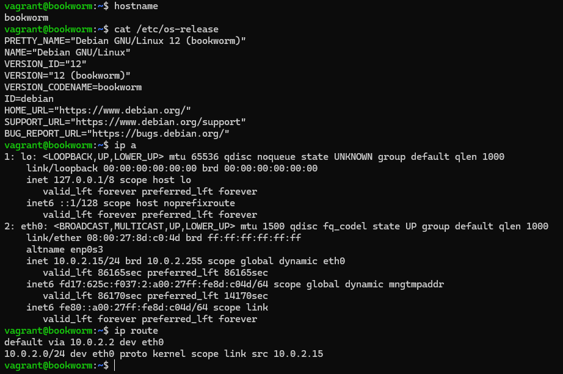
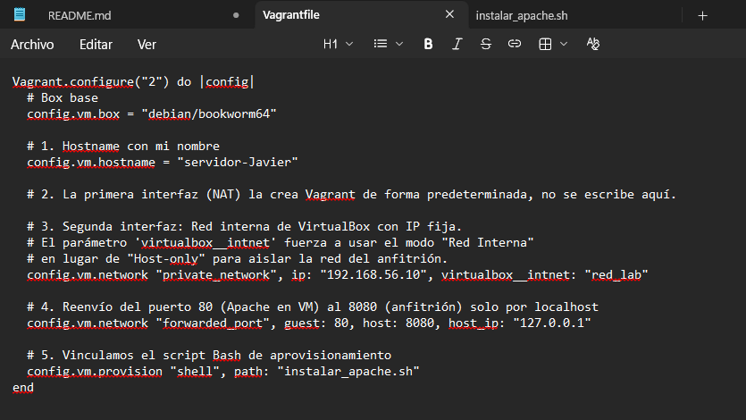
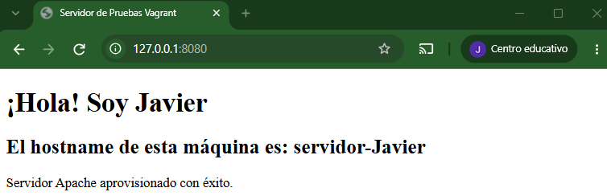
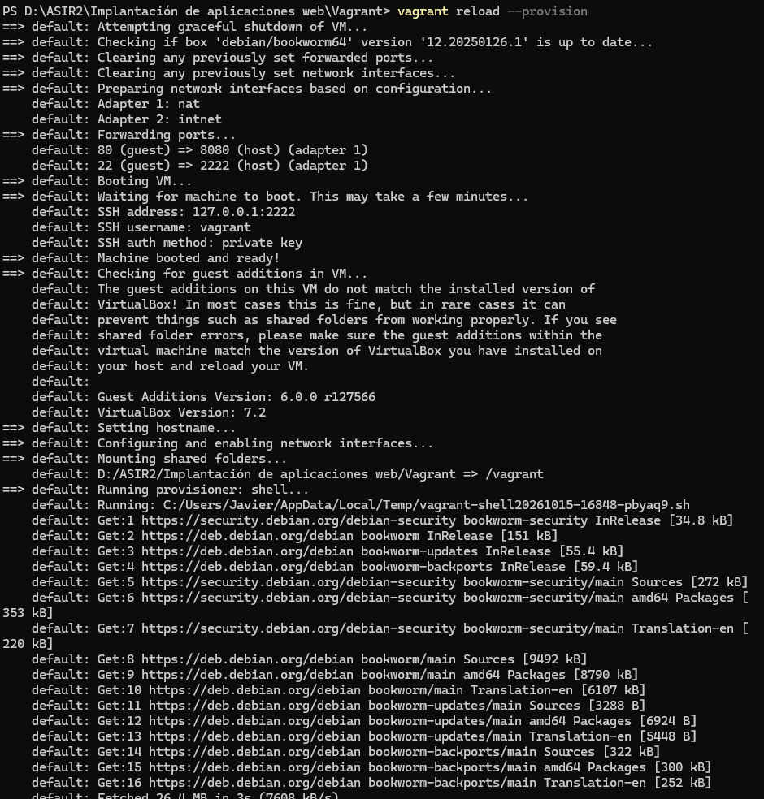

# Tarea1.1.2

## Parte A. Investiga antes de modificar el entorno
1. Vagrant y el Vagrantfile.  
Vagrant resuelve el problema de inconsistencia en los entornos de desarrollo, asegurando que algo que funciona en local no funcione en remoto y que las configuraciones sean idénticas.

- **Anfitrión:** Es la máquina física donde se ejecuta la aplicación y desde donde se gestionan los comandos.
- **Proveedor de virtualización:** Es el software hipervisor que gestiona la creación y ejecución real de máquinas virtuales, ya sea VirtualBox, VMware, etc...
- **Box:** Es una imagen base empaquetada de un sistema operativo preconfigurado que Vagrant utiliza como punto de partida para clonar y crear las máquinas virtuales.
- **Máquina Virtual:** Es la instancia de sistema operativo que se ejecuta dentro del proveedor, derivada de la *box*, y  donde se realiza el desarrollo del código.
  * La sintaxis de Vagrantfile es *Ruby*.

2. Aprovisionamiento.  
Un provisioner es una herramienta que usa Vagrant para instalar software, cambiar configuraciones o preparar la máquina automáticamente después de que haya arrancado.  
El script se ejecuta dentro de la máquina virtual, habitualmente con privilegios de root.  
Vagrant se lanza automárixamente solo la primera vez que se ejecuta *vagrant up*.

- Inline: Permite escribir los comando directamente dentro el archivo *Vagantfile* como una cadena de texto. Es útil para configuraiones muy cortas.
- Path: Especifica la ruta a un archivo de script externo guardado en tu anfitrión. Es la mejor prácticas para scripts largos.

Si modificas el script despues del primer *vagrant up*, Vagrant no lo volverá a ejecutar automáticamente si haces un *vagrant reload* o *vagrant up*.

Para ejecutarlo de nuevo tienes que forzar su ejecución usando el comando *vagrant provision* o *vagrant up --provision*

3. Interfaces y redes.
Vagrant por defecto configura la primera interfaz en modo NAT. La utiliza para que la máquina virtual tenga salida a internet y para poder conectarse por SSH.
Para añadir una segunda interfaz con dirección fija en el Vagranfile, se añade con el comando *config.vm.network "private_network", ip: "192.168.56.10"*.  
- NAT: LA máquina virtual sale a internet a través del anfitrión, pero la VM está invisible para la red externa y para el propio anfitrión.
- Red interna: Es un entorno de red aislado, sirve para que dos o más máquinas se comuniquen entre sí de forma segura. En el Vagrantfile se configura añadiendo el parámetro *virtualbox__intnet*.
- red privada: Crea como un switch virtual en tu ordenador. Permite que las máquinas se comuniquen entre sí, y el anfitrión sí está conectado a esa red y puede comunicarse directamente con las máquinas virtuales.
- red pública: La máquina virtual se conecta a tu red física y pide una IP al router, y es visible para cualquier otro dispositivo de tu red local.  
El reenvio de puertos permite acceder a un servicio de la máquina virtual apuntando a un puerto de tu máquina física.
Añadirla no elimina la NAT predeteminada, sigue existiendo y la nueva red se configura como segunda interfaz.
El reenvio de puertos no crea una nueva interfaz, sino que reutiliza la interfaz NAT existente configurando reglas de enrutamiento.
4. Órdenes y carpeta compartida

| Orden | Cuándo se usa |
| --- | --- |
| up | Para crear y arrancar la máquina virtual por primera vez, o para encenderla. |
| status | Para comproabr si la máquina está encendida, apagada o no está creada. |
| ssh | Para entrar a la terminal de la máquina virtual |
| reload | Para reiniciar la máquina |
| provision | Para forzar la ejecución de los scripts de aprovisonamiento sin tener que reiniciar la máqina |
| halt | Para apagar la máquina virtual |
| destroy | Para eliminar completamente la máquina virtual y liberar el espacio en el disco |

## Parte B. Mi primera máquina en Vagrant

- Antes de nada deberé descargar Vagrant en mi ordenador

Una vez descargado crearemos una carpeta llamada vagrant y abriremos un terminal en ella, donde iniciaremos vagrant desde ahí

Para ello ejecutaremos los siguientes comandos:  
`vagrant init debian/bookworm64`  

`vagrant up`  

Una vez termine de arrancar la máquina, entraremos con ssh:  
`vagrant ssh`

  

## Parte C. Completa el Vagrantfile  

* Código del vagrantfile  
Vagrant.configure("2") do |config|  
  config.vm.box = "debian/bookworm64"  - Descarga la imagen de Debian 12  
  config.vm.hostname = "servidor-Javier" - Asigna el nombre a la máquina  
  
  <!-- Segunda interfaz en modo Red Interna (aislada del host) -->  
  config.vm.network "private_network", ip: "192.168.56.10", virtualbox__intnet: "red_lab"  
  
  <!-- Reenvía el puerto 80 de la VM al 8080 del host, solo accesible desde localhost -->  
  config.vm.network "forwarded_port", guest: 80, host: 8080, host_ip: "127.0.0.1"  
  
  <!-- Llama al script externo para instalar Apache -->  
  config.vm.provision "shell", path: "instalar_apache.sh"  
end  

## Partes D. Aprovisiona Apache
Deberemos crear un fichero .sh con un script que instale apache en Debian 12  

* Codigo del .sh  
  #!/bin/bash
<!-- 1. Actualizamos la lista de paquetes -->  
apt-get update  

<!-- 2. Instalamos Apache2 -->   
apt-get install -y apache2  

<!-- 3. Nos aseguramos de que el servicio se active e inicie automáticamente -->  
systemctl enable --now apache2  

<!-- 4. Obtenemos el hostname actual de la máquina -->  
HOSTNAME_ACTUAL=$(hostname)  

<!-- 5. Creamos una página web sencilla sobreescribiendo el index.html por defecto -->  
cat <<EOF > /var/www/html/index.html  
<!DOCTYPE html>  
<html lang="es">  
<head>  
    <meta charset="UTF-8">  
    <title>Servidor de Pruebas Vagrant</title>  
</head>  
<body>  
    <h1>¡Hola! Soy Javier</h1>  
    <h2>El hostname de esta máquina es: $HOSTNAME_ACTUAL</h2>  
    
Servidor Apache aprovisionado con éxito.
  
</body>  
</html>  
EOF  

echo "Aprovisionamiento de Apache finalizado."  
